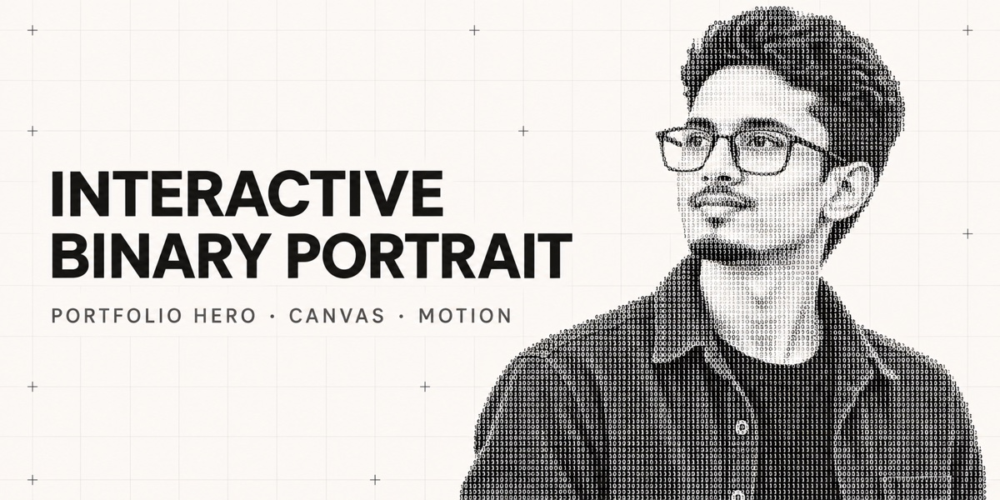

# Interactive Binary Portrait Hero Animation



A standalone, responsive portfolio hero built with HTML, CSS, and the Canvas API. It recreates the binary portrait artwork from the original portfolio and adds interactive particle motion, scrambled text reveal, and staggered entrance animations.

## Preview

The page contains a custom portrait rendered from binary digits, the hero copy, a grid overlay, and button styled social icons. The portrait responds to pointer movement on desktop. The layout adapts to smaller screens and respects the device's reduced motion preference.

## Run locally

Requirements: Node.js and Python 3. No npm packages need to be installed.

```sh
npm run dev
```

Open [http://localhost:4173](http://localhost:4173) in a browser. Stop the server with `Ctrl+C`.

## Project files

```text
.
├── app.js
├── assets/
│   ├── github-thumbnail.jpg
│   └── rafsan-hero.webp
├── index.html
├── package.json
└── styles.css
```

`assets/github-thumbnail.jpg` is the README cover. `assets/rafsan-hero.webp` is the transparent source portrait used to render the canvas artwork. To use a different portrait, replace the WebP file while keeping its filename and transparent background.

## Technologies

- HTML for the page structure and social icon SVGs
- CSS for the responsive layout, grid, button styling, and entrance animations
- Vanilla JavaScript and Canvas for the binary portrait, pointer interaction, and scramble reveal
- Python's built-in static server, started through the npm `dev` script

The social buttons are presentation only until profile URLs are added.
